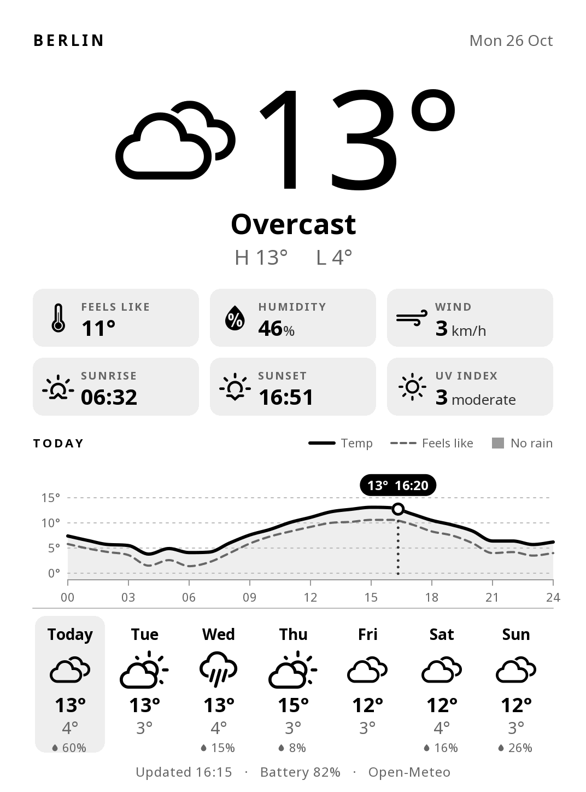
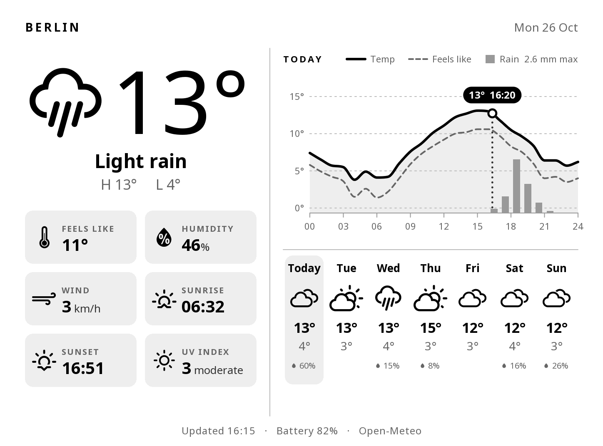

# Kindle Weather Screensaver

[](https://github.com/NUCL3ARN30N/kindle-weather/stargazers)
[](https://github.com/NUCL3ARN30N/kindle-weather/network/members)
[](https://github.com/NUCL3ARN30N/kindle-weather/issues)
[](LICENSE)


> Turns the sleep screen of a jailbroken Kindle into a weather dashboard that refreshes itself every 15 minutes while the Kindle sleeps

<p align="center">
  
  &nbsp;
  
</p>

## Quick Start

1. Download this repository (green **Code** button → **Download ZIP**) and unzip it.
2. Connect the Kindle over USB and copy the `weatherscreen` folder into the Kindle's `extensions`
   folder, so that you end up with `extensions/weatherscreen/bin/ctl.sh`.
3. Set your location in `extensions/weatherscreen/config.sh` (see [Configuration](#configuration)).
4. Eject and unplug the Kindle, then open **KUAL → Weather Screensaver → Enable**.
5. Press the power button. The weather appears instead of the stock screensaver.

**Enable** does three things: it unloads the stock screensaver, starts the background service, and
registers it to start automatically after reboots. Running it again is harmless, and it's also how
you apply an updated version.

## Features

| #  | Feature                | Description                                                                             |
| -- | ---------------------- | --------------------------------------------------------------------------------------- |
| 1  | **Current conditions** | Feels-like, humidity, wind, sunrise/sunset, UV index                                    |
| 2  | **Forecast**           | Today's temperature curve with rain bars, and a 7-day forecast                          |
| 3  | **Orientation**        | Portrait and landscape — follows how the Kindle is held, or fixed                       |
| 4  | **Made for e-ink**     | High contrast, the 16 native gray levels, no dithering, full refresh on every draw      |
| 5  | **No API key**         | Weather data from [Open-Meteo](https://open-meteo.com/). Free, no account               |
| 6  | **Reversible**         | Replaces the stock screensaver and ads. Disable it and the stock screensaver comes back |

Units are metric (°C, km/h, mm) and the labels are in English.

## Configuration

Open `extensions/weatherscreen/config.sh` on the Kindle in a text editor:

```sh
LAT=52.5200        # latitude, decimal degrees
LON=13.4050        # longitude, decimal degrees
LABEL="Berlin"     # title shown at the top of the screen
INTERVAL_MIN=15    # minutes between updates (minimum 5)
IGNORE_AIRPLANE_MODE=0
ORIENTATION=auto   # auto | portrait | landscape | landscape-flipped
```

To find your coordinates, right-click a spot in Google Maps (the first line of the menu shows them),
or search for your town at [open-meteo.com](https://open-meteo.com/en/docs).

> Save the file with **Unix (LF) line endings**. Notepad on Windows 10/11, VS Code and Notepad++ keep them as they are. If the screensaver doesn't start after you edit the file, the line endings are the first thing to check.

Changes to `config.sh` apply at the next update. Tap **Refresh now** to apply them immediately.

### Library Shortcuts (optional)

If your jailbreak supports running `.sh` scriptlets from the library (the Universal Hotfix does), copy
the files you want from `weatherscreen/scriptlets/` into the Kindle's `documents` folder. They show up
as books such as **Weather: Enable** or **Weather: Refresh**, so you don't need to open KUAL. Two are
enough for everyday use: `Weather - Enable.sh` and `Weather - Save log.sh`.

## KUAL Menu

| Item                                    | What it does                                                                    |
| --------------------------------------- | ------------------------------------------------------------------------------- |
| **Enable**                              | Installs the background service, starts it, and fetches the weather immediately |
| **Disable (restore stock screensaver)** | Stops everything, removes autostart and brings back the stock screensaver       |
| **Refresh now**                         | Fetches the weather immediately                                                 |
| **Preview (10 s)**                      | Shows the screensaver for 10 seconds                                            |
| **Orientation**                         | Auto / Portrait / Landscape / Landscape (flipped)                               |
| **Status**                              | Shows on screen whether the service runs and when the last update was           |
| **Save log to USB drive**               | Writes `extensions/weatherscreen/log.txt` for troubleshooting                   |

## How It Works

| Part                          | Detail                                                                                                                                                                                                                                            |
| ----------------------------- | ------------------------------------------------------------------------------------------------------------------------------------------------------------------------------------------------------------------------------------------------- |
| **Drawing**                   | `bin/render.lua` turns the Open-Meteo forecast into a grayscale PNG at the screen's resolution, using KOReader's LuaJIT, FreeType and fonts. Weather icons come from the Nerd Fonts symbols KOReader ships                                        |
| **Replacing the screensaver** | The firmware draws its sleep screen through "blanket" renderer modules. The service unloads the `screensaver` and `ad_screensaver` modules, covers the UI with an empty X window so nothing repaints over the image, and draws the PNG with FBInk |
| **Updating while asleep**     | Before the Kindle suspends, the service sets a timed wake-up for the next quarter hour. On waking it fetches new data, redraws, and goes back to sleep                                                                                            |
| **Updating while awake**      | While the Kindle shows the screensaver without suspending (for example on USB power), a timer does the same                                                                                                                                       |
| **Wi-Fi**                     | The Kindle's Wi-Fi doesn't reliably reconnect by itself after waking, so the service turns Wi-Fi off after each update and back on before the next one. It also turns Wi-Fi back on when you unlock the Kindle                                    |
| **Staying alive**             | The service runs from a copy in `/var/local/weatherscreen` under upstart. That way it survives USB connections (which unmount `/mnt/us`) and gets restarted if it ever dies                                                                       |
| **Stale data**                | If the Kindle can't connect, the last forecast stays on screen and the footer says **OFFLINE · last update …**                                                                                                                                    |

Waking up 96 times a day for a short Wi-Fi connection costs battery, more than a Kindle that just
sleeps. Set `INTERVAL_MIN=30` or `60` in `config.sh` if battery life matters more than fresh data.

## Troubleshooting

Run **KUAL → Weather Screensaver → Save log to USB drive**, connect USB and open
`extensions/weatherscreen/log.txt`. Look for these patterns:

| Symptom / log line                             | Fix                                                                                                                                                                            |
| ---------------------------------------------- | ------------------------------------------------------------------------------------------------------------------------------------------------------------------------------ |
| **Stock screensaver shows again**              | Tap **Enable** again. Then check the log for `daemon start` lines and errors right after them                                                                                  |
| **`wifi: not connected`**                      | Make sure a saved Wi-Fi network is in range. If you use airplane mode, set `IGNORE_AIRPLANE_MODE=1`                                                                            |
| **`fetch failed`**                             | Open-Meteo couldn't be reached. Check DNS, or whether you block hosts in `/etc/hosts`. The Kindle's own connectivity check (`spectrum.s3.amazonaws.com`) has to stay reachable |
| **"Updated" time doesn't change while asleep** | The log should show an `rtc wakeup in …s` line every time the Kindle goes to sleep. If it doesn't, save the log and open an issue                                              |
| **Image is sideways**                          | Set the orientation explicitly in KUAL instead of **Auto**                                                                                                                     |
| **KUAL shows "Application Error"**             | That's a KUAL/jailbreak problem, not this extension. Run the hotfix again or reinstall KUAL                                                                                    |

## Uninstall

1. **KUAL → Weather Screensaver → Disable.** The stock screensaver is back right away.
2. Delete `extensions/weatherscreen` and any `Weather - *.sh` files in `documents`.

Disable doesn't delete the small state folder on the internal storage (`/var/local/weatherscreen`,
which holds the cached forecast and the log). It's harmless, and **Enable** reuses it if you come back.

## Testing Without a Kindle

The `test/` folder renders the screen and simulates the service on a Linux PC (WSL works) with stub
versions of the Kindle tools. Unpack the [KOReader](https://github.com/koreader/koreader/releases)
Linux build (`koreader-linux-x86_64-*.tar.xz`) somewhere and point `KOREADER_DIR` at the folder that
contains `luajit` (default: `~/kotest/lib/koreader`).

| Script                      | What it checks                                                          |
| --------------------------- | ----------------------------------------------------------------------- |
| **`sh test/run.sh`**        | Renders `test/weather.json` to `test/out.png`                           |
| **`sh test/variants.sh`**   | Renders portrait, landscape and other screen sizes                      |
| **`sh test/sim.sh`**        | Simulates enable → sleep → timed wake-up → unexpected kill → disable    |
| **`sh test/tickertest.sh`** | Tests updates while the Kindle shows the screensaver without suspending |

## Requirements

| What                  | Notes                                                                                                                                                                          |
| --------------------- | ------------------------------------------------------------------------------------------------------------------------------------------------------------------------------ |
| **Jailbroken Kindle** | For example with [WinterBreak](https://kindlemodding.org/jailbreaking/WinterBreak/) or another jailbreak from [kindlemodding.org](https://kindlemodding.org/)                  |
| **Universal Hotfix**  | Keeps the jailbreak across reboots and installs `libkh`, whose FBInk (`/mnt/us/libkh/bin/fbink`) draws the image. Without it, the script falls back to the Kindle's own `eips` |
| **KUAL**              | Kindle Unified Application Launcher, to turn the screensaver on and off                                                                                                        |
| **KOReader**          | Installed in its default place (`/mnt/us/koreader`). The script borrows its LuaJIT and fonts to draw the image. You don't have to use KOReader for reading                     |
| **Wi-Fi**             | A saved Wi-Fi network in range                                                                                                                                                 |

**Tested on:** Kindle Basic (11th gen, 2022, 1072×1448) with firmware 5.18.5  
**Other models:** The layout scales to other screen sizes (it was also rendered for the Paperwhite 5's 1236×1648), but they haven't been tested on real hardware. Feedback is welcome  
**Disclaimer:** Use at your own risk — jailbreaking and modifying your Kindle is not supported by Amazon

## Credits

| Project                                                                                                                          | Used for                                       |
| -------------------------------------------------------------------------------------------------------------------------------- | ---------------------------------------------- |
| [Open-Meteo](https://open-meteo.com/)                                                                                            | Weather data (CC BY 4.0)                       |
| [KOReader](https://github.com/koreader/koreader)                                                                                 | LuaJIT, FreeType bindings, Noto and Nerd Fonts |
| [FBInk](https://github.com/NiLuJe/FBInk) by NiLuJe                                                                               | Drawing to the e-ink framebuffer               |
| [KUAL](https://www.mobileread.com/forums/showthread.php?t=203326) and the [Kindle Modding](https://kindlemodding.org/) community | Launcher and jailbreak tooling                 |

---

Badges from [envoy1084/awesome-badges](https://github.com/envoy1084/awesome-badges)
